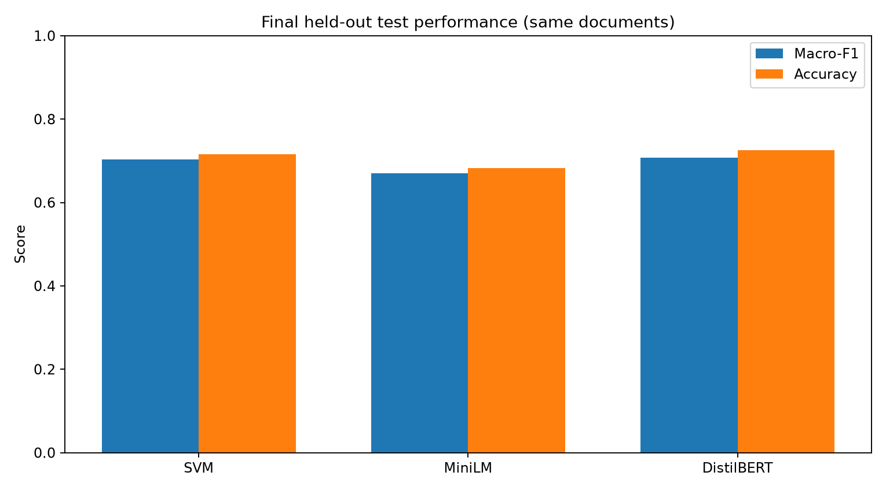

# Multiclass Document Classification — Comparative NLP Portfolio

A reproducible research-oriented Python project comparing **TF-IDF + Linear SVM**, **frozen MiniLM embeddings + Logistic Regression**, and **fine-tuned DistilBERT** for supervised document-topic classification. It includes training scripts, evaluation data, visualizations, automated tests, and a locally verified Streamlit interface. **This is classification into predefined topics, not unsupervised topic discovery.**



## Results on 20 Newsgroups

All models were evaluated on the same **7,317 held-out documents** (20 predefined categories) after consistent document filtering.

| Model | Macro-F1 | Accuracy | Documents per second (recorded inference setup) |
|---|---:|---:|---:|
| TF-IDF + Linear SVM | **0.7029** | 0.7159 | 4,093.4 |
| MiniLM + Logistic Regression | 0.6702 | 0.6822 | 28.8 |
| Fine-tuned DistilBERT | **0.7077** | **0.7252** | 8.6 |

The fine-tuned transformer scored 0.0048 macro-F1 above SVM; the **paired-bootstrap 95% interval included zero**, so the comparison does not establish a definitive advantage. DistilBERT was selected using an **abbreviated exploratory** parameter search, not an exhaustive one. Inference throughput is specific to the recorded setup; the single-document Streamlit timings are not comparable to these batch measurements.

See [methods and results](docs/METHODS_AND_RESULTS.md), [technical verification](docs/TECHNICAL_VERIFICATION.md), and the raw **aggregate** CSVs in [`results/`](results/).

## Datasets and study design

- **20 Newsgroups**: 20 document categories, main held-out experiment ([scikit-learn dataset information](https://scikit-learn.org/stable/datasets/real_world.html#the-20-newsgroups-text-dataset)).
- **AG News**: four news categories, separate training and evaluation ([dataset card](https://huggingface.co/datasets/fancyzhx/ag_news)).
- **arXiv CS Sub-field**: six scientific-abstract categories, separately trained classifiers ([dataset card](https://huggingface.co/datasets/Tiansve/arxiv-cs-subfield)).

The secondary datasets test the **methodology on different text genres**; they are not a zero-shot transfer evaluation of the 20-class models. Additional experiments examine training-set size, preprocessing, stemming on validation data, confusion patterns, and statistical uncertainty.

## Run the project

**Environment:** Python 3.12 recommended. In a fresh virtual environment:

```bash
python -m pip install -r requirements-full.txt
python 02_explore_data.py
```

The numbered scripts progressively create the training artifacts. SVM, embedding, and transformer scripts must be run before `09_compare_models.py`; the full transformer training may require substantial compute and downloaded pretrained weights. **Saved models and original corpora are not included in this repository.** A clean clone can run the lightweight tests and inspect the measured CSVs, but cannot run model inference until compatible models are trained or provided locally.

```bash
python -m pip install -r requirements-ci.txt
python -m pytest -q tests
python 13_verify_project.py
python 17_release_audit.py
```

The release audit checks aggregate numerical consistency and publication-package integrity. It is **not** a full model-training reproducibility test.

## Streamlit interactive demo

Once the trained artifacts are available in their expected paths, start the local browser UI:

```bash
python -m streamlit run 12_streamlit_app.py
```

In a local **one-document smoke test**, the recovered three models all predicted `sci.space` for a spacecraft text; 20 ranked categories per model were exported. See the [demonstration walkthrough](docs/STREAMLIT_DEMONSTRATION.md), [application screenshot](docs/streamlit_app_screenshot.png), and [exported predictions](results/streamlit_demo_predictions.csv). The screenshot records the interface; it is **not** evidence of cloud deployment or representative accuracy.

## Repository structure

- `02_*.py` to `11_*.py`: data exploration, training, evaluation, error analysis, and cross-genre studies
- `12_streamlit_app.py` and `nlp_inference.py`: interactive inference
- `13_verify_project.py`, `17_release_audit.py`, `tests/`, `.github/workflows/`: checks and CI
- `16_stemming_ablation.py`: validation-only stemming experiment
- `results/`: aggregated measurements and plots
- `docs/`: public methodology, verification limitations, and demo evidence

## Limitations and publication scope

- Evaluation covers a historical benchmark; it does not establish real-world domain robustness.
- Training and inference comparisons depend on data splits, preprocessing, hardware, and checkpoint selection.
- The locally verified Streamlit interface is not publicly deployed, stress-tested, or security-audited.
- Document-level benchmark text, model weights, local paths, credentials, and institution-specific examination materials are excluded.
- This **public technical portfolio** intentionally excludes the separate formal academic submission and personal identity information.

## Selected references

- Jurafsky, D., & Martin, J. H. *Speech and Language Processing* (2nd ed., Pearson New International Edition), Sections 3.1 and 23.1.
- Reimers, N., & Gurevych, I. (2019). [Sentence-BERT: Sentence Embeddings using Siamese BERT-Networks](https://aclanthology.org/D19-1410/).
- Sanh, V., Debut, L., Chaumond, J., & Wolf, T. (2019). [DistilBERT, a distilled version of BERT: smaller, faster, cheaper and lighter](https://arxiv.org/abs/1910.01108).
- Scikit-learn contributors. [Text feature extraction and classification documentation](https://scikit-learn.org/stable/modules/feature_extraction.html#text-feature-extraction).

