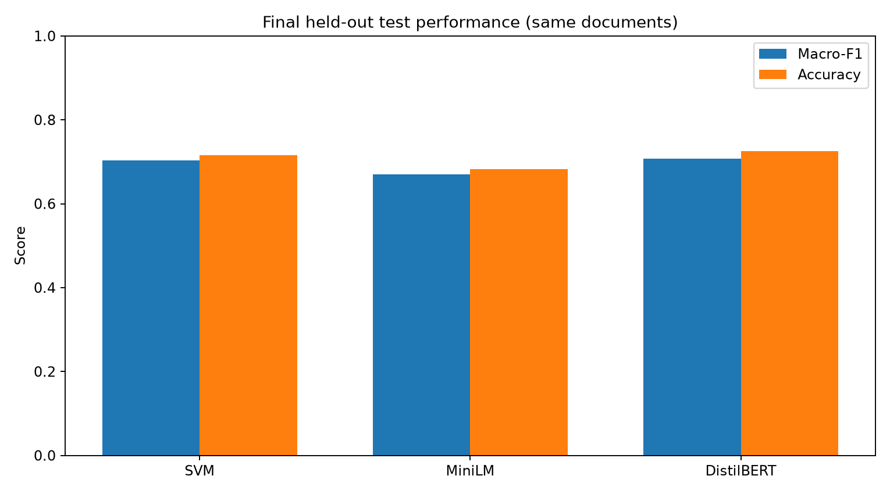

# Methods and measured results — public technical summary

This document explains the software and scientific measurements in this repository. It is **not** the formal university examination report.

## Research question

How do a sparse lexical representation and linear classifier, frozen sentence embeddings and a linear classifier, and a fine-tuned transformer compare on **supervised 20-class document categorization**, in terms of macro-F1, accuracy, speed, and errors?

## Datasets and methodology

**Primary:** scikit-learn 20 Newsgroups; 7,317 nonempty held-out examples after the study's preprocessing/filtering. Training and validation were used to compare configurations and choose saved classifiers. The held-out test split was reserved for the final evaluation.

**Secondary:** AG News (4 labels; 7,600 test samples) and arXiv CS Sub-field (6 labels; 412 test samples). SVM and MiniLM-based classifiers were **retrained separately** on each dataset. These experiments probe the applicability of the recipe to other text genres, not cross-domain prediction with unchanged 20-class weights.

**Pipeline A:** Text → TF-IDF sparse features → Linear Support Vector Machine → category decision scores. The SVM margins should not be interpreted as probabilities.

**Pipeline B:** Text → frozen pretrained `all-MiniLM-L6-v2` encoder → 384-dimensional sentence features → fitted Logistic Regression → category ranking. Probability outputs were not independently calibrated.

**Pipeline C:** Text → tokenizer → fine-tuned `distilbert-base-uncased` sequence classifier → category ranking (maximum 256 tokens in the documented inference path). Softmax outputs were not independently calibrated. Hyperparameters were selected using a limited exploratory search followed by full-training-partition model fitting.

Model comparisons use accuracy, macro-precision, macro-recall and macro-F1; macro-F1 gives each category equal weight, useful when class frequency differs. Saved CSVs record aggregate observations, and included figures visualize model comparisons, training-size trends, errors, and other experiments.

## Held-out comparison

| Model | Test N | Accuracy | Macro-F1 | Inference time for test batch |
|---|---:|---:|---:|---:|
| TF-IDF + Linear SVM | 7,317 | 0.7159 | 0.7029 | 1.787 s |
| MiniLM + Logistic Regression | 7,317 | 0.6822 | 0.6702 | 253.907 s |
| Fine-tuned DistilBERT | 7,317 | 0.7252 | 0.7077 | 850.458 s |

These numbers are transcribed from [`../results/main_test_comparison.csv`](../results/main_test_comparison.csv). Batch throughput is environment-specific. A comparison of DistilBERT minus SVM found **Δ macro-F1 = +0.00477**, with **paired bootstrap 95% interval [−0.00567, +0.01487]** from 1,000 bootstrap replicates. Thus the observed improvement was small and its interval spans zero. Do not infer that DistilBERT is consistently superior across populations or hardware.

## Secondary-genre results

| Dataset | Classifier | Test N | Macro-F1 |
|---|---|---:|---:|
| AG News | SVM | 7,600 | 0.9079 |
| AG News | MiniLM + LR | 7,600 | 0.8895 |
| arXiv CS Sub-field | SVM | 412 | 0.7360 |
| arXiv CS Sub-field | MiniLM + LR | 412 | 0.7101 |

Source: [`../results/cross_genre_test.csv`](../results/cross_genre_test.csv). The datasets differ in label distributions, sizes and text properties, so these scores should not be interpreted as direct like-for-like model generalization across datasets.

## Further analyses

The source and aggregate outputs include nested stratified SVM training fractions, MiniLM and DistilBERT training-size experiments, English Snowball stemming on the **validation** partition, error comparisons by document length, common topic confusions, paired tests, and bootstrap estimates. These analyses are descriptive and conditional on the particular data and experimental choices.

## End-to-end application demonstration

A separate local Streamlit test loaded all three saved models, accepted a constructed spacecraft-related text and produced `sci.space` as their top predicted category. The [demonstration description](STREAMLIT_DEMONSTRATION.md), screenshot, and exported category rankings are bundled. **This is evidence that the interface and model-loading path functioned on one example**; it does not add observations to the held-out classification evaluation.

## Reproducibility boundaries

No model weights, dataset copies, raw individual-document predictions, or institutional submission documents are distributed. The published tests exercise functions with synthetic inputs; CI can verify source integrity and arithmetic using the aggregate outputs without downloading pretrained model weights. A complete re-run requires datasets, the stated software dependencies, compute resources, and training checkpoints produced by the scripts.
